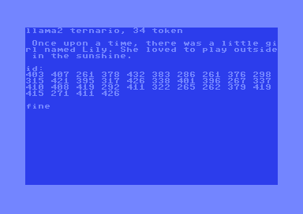
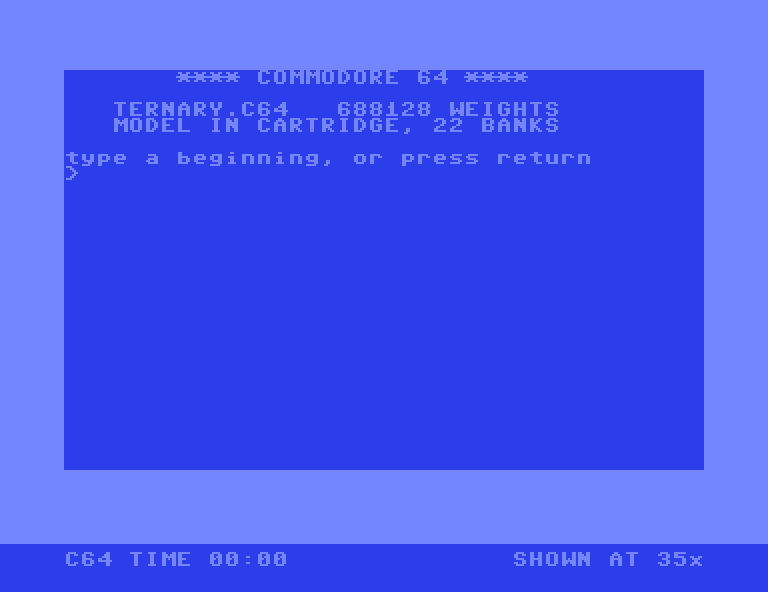

# A ternary transformer on an unexpanded Commodore 64

A 688,128-parameter llama2 transformer with ternary weights, running on a stock
Commodore 64 — no RAM expansion. The model lives in a bank-switched EasyFlash
cartridge. It writes one word every forty seconds or so, and slows down as the
sentence grows.

```
llama2 ternario, 34 token

 Once upon a time, there was a little girl
 named Lily. She loved to play outside in
 the sunshine.
```

That is the same text the model produces in floating point on a PC, token for
token.





Thirty-five real screenshots, one per word, taken by stopping VICE's monitor at
each call to the print routine and saving the screen at that instant. **The
clock is not animated**: it is the emulated cycle count at that frame divided by
the PAL clock, 985,248 Hz. The words get slower as they go — just over 39
seconds at the start, nearly 46 at the end — because the attention has more
context to sum over each time. `src/cattura_film.py` and `src/monta_gif.py`
rebuild it.

---

## What is different here

"AI on a Commodore 64" now covers several very different things. It helps to
separate them by **where the arithmetic actually happens**.

| | what runs where | |
|---|---|---|
| [llama2.c64](https://github.com/ytmytm/llama2.c64) — Maciej Witkowiak, 2025 | 260K llama2 **on the C64** | **needs a 2 MB REU** |
| [C64 AI Module](https://securityfest.com/speakers/2025/integrating-ai-with-retro-hardware-a-commodore-64-llm-module/) — Zmysłowski & Jędrzejczyk, 2025 | LLM **on a co-processor** on the user port | the C64 is a terminal |
| LLM64 | a remote model over a proxy | the C64 is a client |
| [bitnet-6502](https://mattbeton.com/blog/bitnet-6502.html) — Matt Beton, 2026 | 52K ternary Mamba **on a BBC Micro** | other machine, **no attention** |
| **this project** | 688K ternary llama2 **on the C64** | **stock machine, attention included** |

Only two of these run the model on the 6502 itself. One of those needs a memory
expansion; this one does not.

Beton's architecture was chosen to fit 25 KB, which is why it has no attention.
Cartridge banking removes that constraint: the model does not live in the
machine's RAM, it lives in ROM that gets swapped in front of it 16 KB at a time.
That is what makes a full transformer — attention and all — fit on a machine
nobody has modified.

If you know of earlier work on a stock C64, I would like to hear about it —
especially from the demoscene, where things do not end up on GitHub.

---

## Status

Everything here runs in **VICE**, which is cycle-accurate.

**It has not yet been tested on real hardware.** A Kung Fu Flash 2 cartridge is
on the way. Nothing in the design depends on exact timing — no raster tricks, no
cycle-counted loops — so it is expected to work, but until it has actually run
on a real machine, treat the hardware claim as unverified. This note will be
updated either way, including if it fails.

---

## How it works

**Ternary weights.** Every weight is −1, 0 or +1 — two bits — trained from
scratch with BitLinear, per-tensor scale on the median, straight-through
estimator. At dim 64 the ternary model was unusable (val loss 2.25 against 1.81
for the float baseline). At dim 128 it reaches **1.4390**, better than the
float baseline one size down.

**No floating point anywhere on the C64.** Everything is int16 Q5.10. SiLU, the
exponential, the inverse square root and the RoPE rotations are lookup tables —
4096 bytes in total. Matrix scales are precomputed offline as (mantissa, shift)
pairs. Activations are quantised to int8 with a shift, truncating rather than
rounding.

**The ternary kernel does no multiplication.** With weights in {−1, 0, +1} a
matrix-vector product is only additions. A table of the nine possible sums
`±xa ±xb` turns each byte of packed weights into two table reads. **21 cycles
per multiply-accumulate**, down from 55.

The biggest single speedup did not come from faster code. It came from noticing
that the table depends only on the input vector, not on the matrix — `wq`, `wk`
and `wv` all receive the same vector. That took the count from 112 table builds
per token to 32.

**The bottleneck was never the ternary part.** Once the whole token was timed,
the attention turned out to cost **908 cycles per multiply-accumulate against
21 for the ternary kernel**, because the C compiler was emitting a 32×32
multiply. A quarter-square MAC in assembly brought that to 81.

---

## The numbers

| | |
|---|---|
| ternary weights, 2 bits each | 688,128 |
| model file | 242 KB |
| cartridge image | 361 KB, 22 banks |
| cycles per word, short context | 38,619,875 |
| **seconds per word** | **39.2**, rising to **45.9** at full context |
| cycles per ternary MAC | 21 |
| cycles per attention MAC | 81 |
| free RAM left | 256 bytes |
| bit-exact checks passed | **21 / 21** |

The 34 tokens of the sentence above take **24 minutes and 5 seconds**. Every
word costs more than the one before it — 39.2 seconds for the first, 45.9 for
the last — because the attention has one more position to sum over each time.

Those two timings are not estimates. They come from VICE's monitor, stopped at
each call to the print routine, divided by the PAL clock of 985,248 Hz.
`src/cattura_film.py` prints all thirty-four of them.

---

## Running it

The cartridge is self-contained: model, tables, vocabulary and code. Download
`gen.crt` from [Releases](../../releases) and attach it in any emulator with
EasyFlash support:

```
x64sc -cartcrt gen.crt
```

It asks for a beginning. Press RETURN on an empty line and it writes the
sentence above on its own. Or type something and it continues from there:

```
> One day
, a little boy named Tim went to the park with his mom...
```

What you type is tokenised on the machine against the same 512-token
vocabulary the model was trained with, so anything is representable, but only
simple English gets tokenised into whole words. Anything else falls apart into
single letters and the model, which has read nothing but children's stories,
produces nonsense from it.

**A typed prompt is not free.** Every prompt token costs a full forward pass,
the same forty seconds a generated one costs, because the model has to build its
attention cache over it. `One day` is two tokens, so it is well over a minute of
apparent silence before the first new word arrives. That is not a bug you can
optimise away, it is what inference on this machine costs.

Press **Alt+W** for warp mode unless you want to watch it at real speed, which
is the point.

### Rebuilding from source

Needs [oscar64](https://github.com/drmortalwombat/oscar64), a C compiler for the
6502, plus Python 3 with numpy. gcc is needed only for the reference
implementations, not for the cartridge. Exact versions, and what each one is
actually for, are in [docs/REQUIREMENTS.md](docs/REQUIREMENTS.md).

```
cd src
python export_banchi.py    # model -> 28 weight banks + transposed embedding
python make_tables.py      # -> tables.bin
python gen_testo.py        # -> gen.c
.\c64.ps1 gen -Cicli 1600000000
```

`c64.ps1` compiles, scans the generated listing for zero-displacement branches,
runs VICE headless with a cycle cap and saves the final screen as a `.png`. It
looks for the tools in the PATH; if yours live elsewhere:

```
$env:OSCAR64 = "C:\tools\oscar64\bin\oscar64.exe"
$env:VICE    = "C:\tools\vice\bin\x64sc.exe"
```

Everything sits in `src/` as one flat directory. That is deliberate: the
generators use bare relative paths and expect a single working directory, and
rearranging them would mean editing paths inside a chain that is verified
end to end.

**The header of each file is in English; the inline comments are in Italian.**
They were written as the work went along, and they are where the traps are
recorded — translating them would mean editing thousands of lines inside
generators that are verified end to end, which is the kind of tidying this
project has learned to be wary of.

⚠️ **The `.c` files are generated. Never edit them** — edit the Python that
writes them.

⚠️ **Compile with `-O2`, not `-O3`.** `-O3` enables `-Oz`, which places globals
in zero page and collides with the inline assembly.

---

## How it is verified

Every component was checked **bit-exact against a reference implementation in C
on the PC** before the next one was built. Twenty-one checks, twenty-one passed.

```
gcc -O2 -o oracolo_att.exe oracolo_att.c -lm

.\c64.ps1 l04 -Cicli 800000000    # 336 comparisons, 0 errors
.\c64.ps1 gen -Cicli 1600000000   # writes the sentence
```

`l04` compares 21 stages at 16 consecutive positions — the output of every
matrix, the attention, the logits and the argmax — against targets read
directly from the oracle, so the two cannot drift apart.

`gen` has no targets at all. **It is checked by the text it writes**, which is a
stricter test: every token depends on all the previous ones rather than on
supplied values. Six different prompts were compared token by token against the
oracle. No divergence.

Bit-exactness is not the same as matching floating point. On the reference
prompt the fixed-point pipeline produces exactly the same tokens as float; on an
arbitrary prompt it agrees about a third of the time, typically diverging after
fifteen tokens or so. That is a measured property of the
arithmetic, over 150 prompts — not a defect, and worth stating plainly:
**quantisation changes the story.**

---

## What it cost

Every number above was measured on the machine, and several of them were
measured twice because the first measurement was wrong. Five things that cost
real time:

- oscar64's `WORK` scratch area sits at `$03-$0B` and holds values live across
  calls. Inline assembly that writes there kills the program with no message —
  and the same code worked fine as an isolated component.
- `unsigned char * signed char` without explicit `(int)` casts loses the sign,
  and the wrong version was the fastest one.
- A 16-bit timer polled too rarely reports plausible, small, wrong numbers. It
  said the attention cost did not grow with context, which is impossible by
  definition, and convenient to believe.
- Three matrices named `W1`, `W2`, `W3` collided with internal labels inside the
  compiler's 32-bit multiply routine. Jumps landed on the arrays, the assembler
  emitted a zero-length branch without complaint, and the multiply returned
  garbage in silence.
- Two of three "easy" optimisations evaporated when they were actually timed
  instead of inferred. A number obtained by subtraction is not a measurement.

---

## Sixty years, one machine

Three programs that produce English on a Commodore 64, and three different
ideas of what that requires.

**1966 — ELIZA.** Weizenbaum's program ran on the C64 in a few kilobytes of
BASIC: keyword matching, templates, and pronoun reflection — *I am* becomes
*you are*. It answers instantly and never makes a grammatical mistake, because
it cannot: it only ever rearranges the sentence you just gave it. There is no
state and nothing learned. It is a table someone wrote by hand. Weizenbaum
chose the Rogerian therapist deliberately — it is the one human role where
understanding nothing and simply reflecting the question back reads as
competence.

**1987 — a neural network.** John Walker put one on the C64
[in BASIC](https://www.fourmilab.ch/documents/commodore/BrainSim/): two fields
of 42 neurons, 1,764 synapses, an associative memory. You taught it dot
patterns of letters and it recalled them from corrupted or partial input. It
held two or three patterns before they blurred into each other. Walker noted
that the same program could as easily be learning phrases of music or
combinations of medical symptoms — the network does not know what it is
looking at.

**2026 — this.** 688,128 weights, four layers, attention. The sentences are
plain and childish, and every one of them is assembled from weights the model
learned rather than picked off a list nobody wrote. It takes forty seconds a word
and 361 KB of cartridge to do it. ELIZA needed a few KB and answered before you
let go of the RETURN key.

Sixty years of research to make the performance worse and the substance better.

## Credits and licence

Built on **[karpathy/llama2.c](https://github.com/karpathy/llama2.c)** (MIT).
The training and sampling scripts are not redistributed here — `src/patch_train.py`
and `src/patch_sample.py` apply the ternary modifications to a fresh clone, so
what is mine and what is his stays unambiguous.

The model is trained on **[TinyStories](https://huggingface.co/datasets/roneneldan/TinyStories)**
(Eldan & Li), released under CDLA-Sharing-1.0. Section 3.5 of that licence
places no obligations on the publication of Results, which is what trained
weights are; the credit is given because it is owed, not because the licence
demands it.

Prior work by **Maciej Witkowiak** and **Matt Beton** is what defined the gap
this project aims at.

Everything original here is MIT. See `LICENSE` and `NOTICE`.
